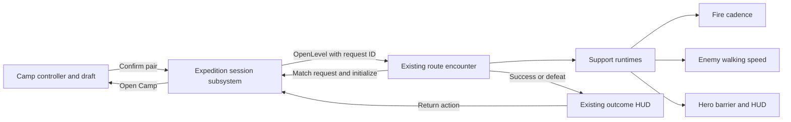

# Camp to expedition handoff

The current route is `/Game/Maps/TestMaps/CombatPrototypeRoute`. Its `BP_CombatPrototypeGameMode`, `BP_CombatPrototypeCharacter`, `DA_CombatPistol`, safe pocket, waves, Torch and exit remain the basis of the expedition. The Camp request adds a confirmed loadout to this entry point. [Plan](ImplementationPlan.md) · [Support skills](SupportSkills.md) · [Current combat wiring](../Architecture.md)

## Session ownership and transitions

Create `Source/GirlSavior/Expeditions/GirlSaviorExpeditionSessionSubsystem.*` as a `UGameInstanceSubsystem`. It survives map travel for one local game session. Define `FGirlSaviorExpeditionLaunch` in `Expeditions/GirlSaviorExpeditionLaunch.h` with `FGuid RunId`, `FName MissionId`, the two ordered ability IDs and ability asset references, and canonical soft map references for origin and destination. Hold the pending payload in reflected transient storage so its asset references stay valid across travel. Treat it as read-only after confirmation. Keep a separate `LastConfirmedAbilityIds` for Camp UI. Actor, controller and widget lifetimes belong to their own worlds. Use weak references for transient request-origin or claiming-world identity.

| Owner | Operation and result |
| --- | --- |
| Camp controller → `RequestLaunch` | Check that the current local world is the configured Camp and the draft passes catalog validation. Preflight the destination with `UEngine::MakeSureMapNameIsValid` on a local copy of the full package name. Generate a `RunId`, store `LaunchPending` and close the dispatch gate before opening the map. Use `UGameplayStatics::OpenLevelBySoftObjectPtr` with `bAbsolute = true` and an option of the form `CampRunId=<guid>`. Pass only the identifier in the URL. |
| Route encounter → `ClaimLaunch` | In the existing first-pawn initialization path, inspect the local GameMode options via `UGameplayStatics::HasOption` and `ParseOption`. A valid GUID matching a pending ID and full destination map in the same game instance reserves the payload once. Revalidate the ability references, IDs and effect pair before attaching them. If the expected destination has an unclaimed pending request but the option is absent, enter recovery as a failed Camp launch. If the option is present and malformed, unmatched or already claimed, reject it. A duplicate claimant leaves the original claim and current run untouched. Absence with no matching pending destination takes the standalone path. |
| Route encounter → `CommitLaunch` | When `InitializeRun` has succeeded and support is attached, consume `LaunchPending`, mark `InExpedition`, and copy the accepted pair to `LastConfirmedAbilityIds`. Retain the run ID and return map for this route. An invalid or already claimed token cannot grant skills or silently launch a Camp-origin fight. |
| Encounter → `RequestReturn` | Allow the outcome action while `IsOutcomeVisible()` and the matched session is `InExpedition`, or when the session is in `Recovery` for this route. Preflight Camp, set `ReturnPending` before calling absolute `OpenLevelBySoftObjectPtr`, and lock the result button during the request. Preserve the displayed result or diagnostic and restore input focus if return fails. |
| Camp controller → `NotifyCampReady` | When the local pawn is possessed and the normalized map matches the configured return package, retire `ReturnPending` and the active run ID. The remembered pair remains available to seed the next draft. |

Compare the soft pointer's long package name to `UWorld::RemovePIEPrefix(World->GetPackage()->GetName())`. Use the map package name in logs and a weak world pointer for instance ownership. Snapshot IDs and Data Asset references before travel. Validate destination options from `AGameModeBase::OptionsString` and scope callbacks to the current game instance even in PIE. [Epic gameplay statics](https://dev.epicgames.com/documentation/en-us/unreal-engine/API/Runtime/Engine/UGameplayStatics) · [Epic game-instance subsystem](https://dev.epicgames.com/documentation/en-us/unreal-engine/API/Runtime/Engine/Subsystems/UGameInstanceSubsystem)

### Failure paths and lifetime

- A validation or synchronous preflight failure keeps the origin usable. Report the failure to the Camp panel with the draft and focus intact, or re-enable and refocus `В лагерь` on the result panel. If dispatch fails in a controlled path that retains the origin, clear `LaunchPending` or roll `ReturnPending` back to its prior `InExpedition` or `Recovery` phase before restoring the UI.
- Subscribe to `UEngine::OnTravelFailure` and `FCoreUObjectDelegates::PostLoadMapWithWorld` in subsystem `Initialize`. Remove both bindings in `Deinitialize`. Filter by game instance, weak world identity and pending phase, and include the current request ID in logs. A late engine failure may load the default map or schedule a disconnect even if the old world still exists at notification. Let the engine finish recovery. Clear the pending request when its origin is replaced or an unrelated world loads. Write diagnostics and avoid touching discarded widgets. In the expected destination, keep the request until the encounter claims it or the Camp controller acknowledges possession.
- If `InitializeRun` or a later Camp-origin hero rebind fails, unwind partial hero/effect binding, close gameplay input and enter `Recovery` with the trusted Camp map. Show a focused diagnostic and `В лагерь` in the existing result widget before normal encounter completion. A rejected token on the expected destination can use this path when there is a trusted pending request. Record the remembered pair only after a valid initial commit. A token with no trusted session shows a diagnostic without granting effects. The existing route's GameMode, local hero class, encounter and HUD are required authored dependencies. Gate the full map on these checks in the editor and the acceptance smoke test.
- A terminal encounter stops support immediately, while the active session continues to own the return request. Close the effect dispatch gate synchronously in `CloseRun`. If death arrives from the receiver's `OnDied` during hit resolution, defer physical detach to the existing `bCleanupPending` tick so the committed damage result can finish publishing. `EndPlay` releases every world-local timer, subscription and modifier even if no further tick runs. Map travel creates a fresh hero. The next launch gets a new `RunId` and new runtime instances. Direct starts, including combat Retry, carry no Camp token. Leaving the play session deinitializes the subsystem and its remembered pair.

## Combat attachment points

| Existing source | Integration |
| --- | --- |
| `Encounters/GirlSaviorCombatEncounter.*` | Claim during `InitializeRun` before the encounter can enter `Active`. Create and validate the runtime effect instances before applying them. Attach the effects through `BindHero` after vitals and combat fire configuration are known good, before `OnHeroChanged` binds presentation. Complete the overall initialization and then commit the claim. Roll back a partial install on failure. Use `UnbindHero`, `CloseRun` and `EndPlay` as idempotent detach boundaries, keeping the immutable pair available for a hero rebind within the same run. Read the result of `BindHero`, including in the current pawn-change branch. A failed rebind closes Camp-origin gameplay and offers recovery. Standalone setup keeps the existing baseline path. |
| `Combat/GirlSaviorFireComponent.*` | For Ida, add a gun-rate multiplier owned by this fire component, default `1.0`. Validate `CombatPistol->ShotsPerSecond * Multiplier` as finite and positive with the actual pistol before accepting the install. Set the multiplier while attached and reset on detach. Keep the existing runtime rate guard and pass the effective rate to `Schedule.Launched`. At the current base `4`, rate is `4.24` shots/s and the ideal interval for subsequent launches is about `0.236` s, up to frame quantization. Keep the existing pending deadline semantics. Confirm that launch and cue count still match. |
| `Combat/GirlSaviorTestProjectile.cpp` and `Enemies/GirlSaviorEnemyCharacter.*` | For Liora, forward a post-resolver hero weapon result and the hit actor through the current encounter. From the existing pistol source `Hero.Pistol`, require a live registered enemy, `Applied`, a direct hit, and positive `HealthLost + BarrierLost`. Ignore geometry, training targets, friendly/blocked/zero hits, and lethal hits. Feed the slowing runtime only after `ResolveDamage` returns. The runtime owns weak affected-enemy entries and refreshable one-shot timers by game time. Apply `Definition->WalkSpeed * (1 - SlowFraction)` through a named movement modifier seam on the enemy. Clear it at expiry, enemy retirement, or detach. Reapply from base on repeat hits and keep the expiry tied to the most recent valid hit. Charger movement from `ChargeSpeed` and attack phase durations keep their authored values. |
| `Combat/GirlSaviorDamageReceiverComponent.*` and `Encounters/GirlSaviorCombatHUD.*` | For Saira, add an explicit run-scoped barrier grant to the receiver. Install a full additional pool worth `MaxHealth * HealthFraction`, and detach the grant while preserving the receiver's baseline pool. The receiver owns live cap, current barrier and clamping. Keep absorption in `ResolveDamage` after existing resistance and protection checks. The runtime subscribes to resolved hero damage. Any committed loss of barrier or health refreshes one game-time recharge timer, including a fully absorbed hit. Blocked hits leave the timer alone. On expiry, refill through a receiver method and publish an explicit barrier-change event so the existing HUD refreshes. Cancel timers and unsubscribe before detaching. Skip recharge if hero invalid, dead, or run terminal. |
| `Encounters/GirlSaviorCombatHUD.*` and `Encounters/GirlSaviorCombatWidgets.*` | Reuse the result panel and lethal notice. Add an action label and an intent callback for Camp-origin `В лагерь`. Pass a recoverable failure back to the widget so it can restore the enabled state and keyboard focus. Retain the existing `Повторить` and `Retry()` path for direct map starts. Keep the 1.25 s game-time defeat delay. While recovery or an outcome panel owns focus, skip the HUD's deferred `FocusGameplayViewport` call. Use view-only status text for launch or return failure. |

For the barrier grant, use a distinct support pool layered before any pre-existing barrier. Expose the sum of current pools through `GetBarrier()` and in `FGirlSaviorDamageResult` so existing hit, break and HUD paths still see one total. When support expires, remove only the support pool. When it recharges, fill only that pool. Preserve the existing asset's initialization and the barrier fixture. Adjust the HUD's denominator to use effective maximum barrier for as long as the grant is installed. Verify both zero baseline and a nonzero baseline in native tests.

Keep support disabled on the standalone path via an absent run object and neutral defaults. Use game time for timed effects. A terminal or detached run cannot apply a new effect in a projectile or damage callback. Validate configuration before side effects and keep the existing encounter admission and damage resolver authoritative.

## Build and diagnose

- Add `/Game/Maps/TestMaps/CampPrototype` and `/Game/Maps/TestMaps/CombatPrototypeRoute` to the selected packaging map list while preserving existing expected maps. Verify the target list used by the actual cook command. Soft level references also need a real cooked round trip. Keep `Demo` as the default entry point. [Epic packaging settings](https://dev.epicgames.com/documentation/en-us/unreal-engine/project-section-of-the-unreal-engine-project-settings)
- Log the run ID, mission ID, selected ability IDs and map package at request and claim. Log effect attach, cleanup and travel errors with the same run ID. Test a missing map or rejected request using a disposable fixture or a controlled test seam. Verify that the active map and play session remain usable after a recoverable failure.
- Add focused Automation coverage under `Source/GirlSavior/Tests/` for pair validation, state transitions and stale data, and the three mechanics. Exercise the actual map travel, input focus and outcome widget in PIE or Standalone as described in the [acceptance cases](ImplementationPlan.md#acceptance-cases).
