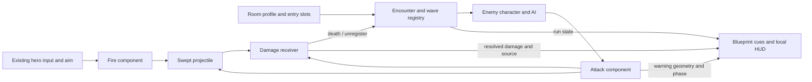

# Combat prototype implementation plan

Build one playable Unreal Engine 5.9 greybox route. The player enters from a safe pocket, moves and aims with the existing controls, shoots with LMB, dodges with Left Shift, meets each of the three ordinary enemies, and reaches a mixed-wave room. The player can reach the exit or die and restart. Run this route in a dedicated map so the original Demo remains available for regression checks.

**Status.** Implementation specification, 2026-11-21. Names, layout choices, and tuning marked as prototype values are proposed for the first playable build. Record measured behavior during implementation.

## Start here

1. Read the [current architecture](../Architecture.md), the owning stage below, and its source design. Use the [Unreal implementation rules](../ImplementationRules.md) and the project's `stage-orchestrator` workflow for execution.
2. Open `GirlSavior/GirlSavior.uproject` in the installed UE 5.9 build. Recheck the current source and assets before changing anything. The plan was checked against source, config, and asset paths on 2026-11-21. The current receiver only validates and accumulates damage. Stage 5 dash is an implementation dependency of full acceptance.
3. Keep one runtime module. Put shared hit and projectile code in `Source/GirlSavior/Combat/`, enemy behavior in `Enemies/`, and room and wave orchestration in `Encounters/`. Keep C++ authoritative for gameplay. Author child Blueprints, greybox meshes, presentation, and level instances in the editor. Use reusable Data Assets for enemy definitions and wave profiles. Document every new Data Asset property, including nested fields, in Russian as required by the project rules.

## Stage order and gates

| Stage | Work in order | Gate before continuing |
| --- | --- | --- |
| **CP0 · Integration baseline** | Build the current Editor target. Verify existing Demo move, aim, fire, camera, and Stage 4 safe-area behavior. Implement and accept the movement/input part of [Stage 5](../Prototype%231/Stage05-DefensiveDash.md) if still missing. Coordinate Stage 5's damage step with CP1 to add protection to the one receiver. | Record the baseline on the current checkout. Verify the real grounded dash, interruption and the live protection query before claiming dash acceptance in CP1. |
| **CP1 · Damage and first fight** | Implement the [damage pipeline](DamageSystem.md) and the [encounter foundation](EnemyWaves.md#encounter-foundation-for-cp1). In `CombatPrototype`, place the player, safe pocket, cover, a health target, and a single Pursuer in a navmesh lane. Wire the basic sector, hit, and death cues at this stage. | Hero kills the Pursuer. Walking out of the sector avoids the hit. Contact during dash protection leaves Health and Barrier intact. Death shuts down a fight and permits restart. The old Demo target and cadence still work. |
| **CP2 · Base roster** | Add [Shooter and Charger](BasicEnemies.md), individual test lanes and the shared dangerous-attack slot. Add their line, projectile, and stripe cues before tuning. | Show all three roles individually, then put a Shooter and Charger in the same test room. At most one dangerous threat is active. Cover, walk-off escape, ally blocking, interrupted windup and posthumous projectile all behave as specified. |
| **CP3 · Waves and route** | Add [room profiles, entrance groups, reserves and the run registry](EnemyWaves.md). Build a connected route and connect entry, exit, safe boundary and encounter cleanup. Move placed test enemies away from the main route or register them explicitly as fixture enemies. | Complete a continuous route with first encounters and mixed reinforcements. Log counts and elapsed times in the fast-kill, backlog, invalid-door, camera-edge, quiet-room and terminal cases. |
| **CP4 · Feedback and acceptance** | Finish [combat feedback](CombatFeedback.md), HUD, dark test setup, and defeat cause. Run the integrated suite and the real camera playtest at more than one viewport aspect ratio. Tune through Data Assets and record values and results. | One map is playable from fresh start to exit or death, and Retry starts a clean session. Record quantitative checks, visual observations and any deferred GDD scenarios. |

## Responsibilities and data flow



| Owner | Implementation boundary |
| --- | --- |
| `UGirlSaviorFireComponent` and existing player classes | Own input, aim, fire cadence and dash. Load projectile configuration through the configured projectile class. Death uses the existing controller input gate and dash interruption. |
| `AGirlSaviorTestProjectile`, `UGirlSaviorDamageReceiverComponent` | Projectile owns swept travel and a single contact outcome. Receiver owns health, barrier, protection, ordered state updates and the lethal snapshot. Calls carry source data by value. |
| `AGirlSaviorEnemyCharacter`, `AGirlSaviorEnemyAIController`, `UGirlSaviorEnemyAttackComponent` | Character owns composition and body lifetime. AI owns navigation intent. Attack component owns phase, geometry and damage delivery. Definitions supply tuning. |
| `AGirlSaviorCombatEncounter`, `AGirlSaviorCombatRoom` | Placed per-map encounter owns run state, registered combatants, scheduled groups, and the right to start one dangerous attack. Room actors own authored identity, topology, spawn slots, and profile selection. |
| Blueprint presenters and UMG | Observe snapshots and typed events. Construct marks, sounds, camera-safe visuals, and HUD. Missing cosmetic assets leave gameplay intact. Required warning setup is validated before admitting a dangerous attack. |

Use game-thread updates and game-time seconds for gameplay clocks. AI/path refresh and wave queries have explicit intervals. A one-shot state transition may occur at most once for the event it consumes, including after a hitch. Use the owning local player's current constrained view in `TG_PostUpdateWork` for new warning and spawn eligibility. Keep cumulative timers as deadlines, clear bindings and world-local state on EndPlay, and write diagnostics to named log categories. [Epic tick order](https://dev.epicgames.com/documentation/en-us/unreal-engine/actor-ticking-in-unreal-engine)

## Assemble the Editor map

1. Create `Content/Maps/TestMaps/CombatPrototype.umap`. Open it directly for PIE or standalone. Set World Settings → GameMode Override to a `BP_CombatPrototypeGameMode` child of the existing prototype GameMode Blueprint. Set its Default Pawn Class to `BP_CombatPrototypeCharacter`, a child of `BP_PrototypeCharacter` with the combat pistol and HUD vitals presets. Inherit the existing controller, input mapping and camera settings. Keep the existing startup map.
2. Lay out a flat safe start pocket with one PlayerStart, then a Pursuer lane, Shooter room with a walk-around column, Charger room with clear side escape and a stop wall, quiet connector, mixed room and a marked exit. Start with combat footprints around **2400 × 2400 cm**. Fit rooms and linked corridors to the actual camera. Add the existing camera room bounds to each footprint and preserve foreground wall fade setup. Keep the combat floor near one height for the first pass.
3. Use the attack and wave specs for collision profiles, nav setup, room IDs, entrances and profiles. Place one encounter and one feedback presenter. Use simple collision on walls, floor, cover, closed test doors, and safe boundary. Author at least two possible entrance directions in the mixed room and enough depth to allow offscreen approach. Press **P** in the Editor to inspect NavMesh coverage. [Epic navigation overview](https://dev.epicgames.com/documentation/en-us/unreal-engine/navigation-system-in-unreal-engine)
4. Start in the safe pocket. Start the run at the first combat-room boundary. Ordinary room transitions are free in both directions. Use the exit trigger to request Success through the encounter. Wire player death to the same terminal path with Defeat. On either terminal state, close gameplay input, cancel reservations and attached attacks, and remove live projectiles and enemies through the encounter's cleanup path. Use a result overlay with Retry. Retry reloads the same map and reinitializes the run, including Health, Barrier, clocks, introductions, and the dangerous slot.
5. Use `Content/Blueprints/Combat/` and `Content/Data/DataAssets/Combat/` for the new Blueprint and data assets. Keep visual-only components collision-free. Use the map's World Settings and authoring validation to catch missing Blueprint classes, room references, profile values, and attack cues before accepting the route.

The playable slice uses the starting pistol, three ordinary enemies, and an authored route. Opening the exit is independent of kill count. Use a local prototype barrier fixture, light setup and outcome overlay for the combat checks here. The later expedition systems consume the combat events through the existing design rules for objectives, support, rewards and persistence.

## Evidence for acceptance

- From the repo root, with the Editor closed, build the existing Win64 Development Editor target. Confirm the process exit code and UBT result. Use the compatible toolchain in [Architecture](../Architecture.md).

  ```powershell
  $project = (Resolve-Path -LiteralPath 'GirlSavior/GirlSavior.uproject').Path
  & 'C:/Program Files/Epic Games/UE_5.9/Engine/Build/BatchFiles/Build.bat' GirlSaviorEditor Win64 Development "-Project=$project" -WaitMutex
  ```

- Run the existing fire, movement, aim, and camera checks on Demo as applicable, including the [Stage 4 route](../Prototype%231/Stage04-CharacterShooting.md#step-6--build-and-run-one-firing-scenario-in-pie). Run the new `GirlSavior.Combat` Automation group and the PIE cases listed in the system specs. Reopen the saved map and check its authored assets and Runtime-only dependencies.
- Run the full route from PlayerStart to the exit, then repeat to produce a death from each of the three attacks. Retry and verify a fresh run. In mixed combat, record group times, reservations, maximum roles, and enemy/projectile lifetimes alongside video or manual observations of warnings and feedback at the gameplay scale. Record build, test and manual results separately in the work report and update the relevant open items and current architecture with verified behavior.
