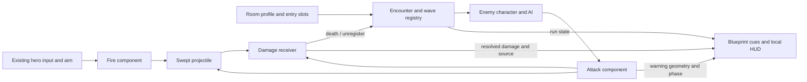

# Combat prototype implementation plan

Build one playable Unreal Engine 5.9 greybox route. The player enters from a safe pocket, moves and aims with the existing controls, shoots with LMB, dodges with Left Shift, meets each of the three ordinary enemies, and reaches a mixed-wave room. The player can reach the exit or die and restart. Run this route in a dedicated map so the original Demo remains available for regression checks.

**Status.** Implementation specification, 2026-11-21. Names, layout choices, and tuning marked as prototype values are proposed for the first playable build. Record measured behavior during implementation.

## Start here

1. Read the [current architecture](../Architecture.md), the owning stage below, and its source design. Use the [Unreal implementation rules](../ImplementationRules.md) and the project's `stage-orchestrator` workflow for execution.
2. Open `GirlSavior/GirlSavior.uproject` in the installed UE 5.9 build. Recheck the current source and assets before changing anything. The plan was checked against source, config, and asset paths on 2026-11-21. The current receiver only validates and accumulates damage. Stage 5 dash is an implementation dependency of full acceptance.
3. Keep one runtime module. Put shared hit and projectile code in `Source/GirlSavior/Combat/`, enemy behavior in `Enemies/`, and room and wave orchestration in `Encounters/`. Keep C++ authoritative for gameplay. Author child Blueprints, greybox meshes, presentation, and level instances in the editor.

## Balance settings in Data Assets

Author gameplay balance in separate typed `UDataAsset` instances under `Content/Data/DataAssets/Combat/`. Each value has one asset owner. Blueprints and placed actors reference the relevant assets. C++ validates and reads their values. Tables in the specs give the initial values to enter in the assets. Keep combat tuning out of C++ constants, Blueprint graphs, and per-instance overrides.

| Data Asset | Values it owns | Reader |
| --- | --- | --- |
| `DA_HeroCombatPrototype` | Initial health, barrier and resistances | Hero damage receiver at initialization |
| `DA_PrototypeDash` | Distance, duration, protection window, cooldown and minimum travel at admission | Existing hero movement component |
| `DA_CombatPistol` | Damage, shots per second, projectile radius, speed and range | Existing FireComponent and shared projectile launch helper |
| `DA_EnemyPursuer`, `DA_EnemyShooter`, `DA_EnemyCharger` | Per-role health, movement and attack geometry, damage and phase durations. The Shooter asset also supplies its projectile settings. | Enemy character, controller and attack component |
| `DA_CombatWaveSettings` | Shared population and role caps, group size, minimum gap and spawn admission tuning | Encounter |
| One `DA_WaveProfile_*` per pressure profile | Target count, refill threshold, interval, role recipes and empty-frame acceleration | Encounter through the current room's profile reference |

Document each Data Asset property, including nested fields, in Russian. Validate required references and field ranges before activating combat. Copy the values needed by an accepted shot, attack or dash into its runtime state. Keep current health, reservations, and cooldown deadlines in runtime instances. For balance acceptance, change a value in a Data Asset, start a fresh PIE run, and verify the corresponding behavior through the normal gameplay path with the same map and Blueprints.

## Stage order and gates

| Stage | Work in order | Gate before continuing |
| --- | --- | --- |
| **CP0 · Integration baseline** | Build the current Editor target. Verify existing Demo move, aim, fire, camera, and Stage 4 safe-area behavior. Implement and accept the movement/input part of [Stage 5](../Prototype%231/Stage05-DefensiveDash.md) if still missing. Coordinate Stage 5's damage step with CP1 to add protection to the one receiver. | Record the baseline on the current checkout. Verify the real grounded dash, interruption and the live protection query before claiming dash acceptance in CP1. |
| **CP1 · Damage and first fight** | Implement the [damage pipeline](DamageSystem.md) and the [encounter foundation](EnemyWaves.md#encounter-foundation-for-cp1). In `CombatPrototype`, place the player, safe pocket, cover, a health target, and a single Pursuer in a navmesh lane. Wire the basic sector, hit, and death cues at this stage. | Hero kills the Pursuer. Walking out of the sector avoids the hit. Contact during dash protection leaves Health and Barrier intact. Death shuts down a fight and permits restart. The old Demo target and cadence still work. |
| **CP2 · Base roster** | Add [Shooter and Charger](BasicEnemies.md), individual test lanes and the shared dangerous-attack slot. Add their line, projectile, and stripe cues before tuning. | Show all three roles individually, then put a Shooter and Charger in the same test room. At most one dangerous threat is active. Cover, walk-off escape, ally blocking, interrupted windup and posthumous projectile all behave as specified. |
| **CP3 · Waves and route** | Add [room profiles, entrance groups, reserves and the run registry](EnemyWaves.md). Build a connected route and connect entry, exit, safe boundary and encounter cleanup. Move placed test enemies away from the main route or register them explicitly as fixture enemies. | Complete a continuous route with first encounters and mixed reinforcements. Log counts and elapsed times in the fast-kill, backlog, invalid-door, camera-edge, quiet-room and terminal cases. |
| **CP4 · Feedback and acceptance** | Finish [combat feedback](CombatFeedback.md), HUD, dark test setup, and defeat cause. Run the integrated suite and the real camera playtest at more than one viewport aspect ratio. Tune through Data Assets and record values and results. | One map is playable from fresh start to exit or death, and Retry starts a clean session. Record quantitative checks, visual observations and any deferred GDD scenarios. |

### CP0 execution record · 2026-11-21

- CP0 verifies the Demo baseline and delivers the Stage 5 movement, input, tuning and live protection query. CP1 owns damage filtering and the first combat encounter.
- The baseline was `0b1a14264d41c6ab664a2b5d77e8e781ef531269` on `main`. Draft changes to combat specifications and Stage 5 plus untracked `Archive/` were already present.
- **CP0 is technically verified.** `BP_PrototypeCharacter` loads `DA_PrototypeDash` on its movement component. A fresh editor process read back the saved asset and its values.
- Win64 Development Editor built successfully. All three `GirlSavior.` tests passed. The dash test includes admission sweeps, real capsule sweeps at 30 and 60 Hz, steps and edges, and the strict protection deadline.
- In Demo PIE, `GirlSavior.TestDash` passed 12 checks in a focused viewport. The capsule travelled 300.000 cm in 0.220000 s. LMB launched a shot during the dash and continued at 4 shots/s. Protection expired while the dash was still moving. A control handoff cancelled a second dash immediately and preserved its ready time. The existing safe area rejected a new dash.
- Walking passed at 30 and 60 Hz. At 960 × 720 and 1280 × 720, the camera and aim probes passed 82 and 58 checks respectively per size. The combat probe passed 37 checks, including real safe-area overlap and possession.
- Build, Automation, and PIE captures are under `GirlSavior/Saved/CP0/`. Use the live protection query in CP1's shared damage receiver. The full [Stage 5 route](../Prototype%231/Stage05-DefensiveDash.md#step-7--build-and-run-one-dash-acceptance-route-in-pie) includes the damage and presentation checks.

### CP1 execution record · 2026-11-22

- **CP1 is technically verified.** It was built on the verified, uncommitted CP0 checkout at `0b1a14264d41c6ab664a2b5d77e8e781ef531269`. The arena is saved at `/Game/Maps/TestMaps/CombatPrototype`. It includes a safe starting pocket, a health target, cover, a navmesh lane with one Pursuer and a marked exit.
- The saved map was reopened and navigation returned a complete path from the Pursuer spawn to the fight entrance. The hero starts with 100 HP. The Pursuer and health target use 30 HP each.
- The live dash query blocked all three direct deliveries during protection. Area and floor damage applied. A direct hit applied after interruption and after the protection deadline. Separate automation checked barriers, resistance, source attribution, and one-time death dispatch.
- The Pursuer approached over the saved navmesh, showed a locked sector, and swung after the hero walked out of it. Three LMB shots killed the Pursuer and cleared body collision. Shots used the authored 1400 cm range at both 60 and 15 Hz simulation steps. A long sweep stopped on the near face of cover, and the safe pocket intercepted a shot in its open entrance.
- A separate melee hit killed the hero and showed `Удар преследователя`. Retry restored the map, 100 HP and a new 30 HP Pursuer. A second foreground run received movement input and entered combat. The arena exit showed the success panel and closed gameplay input.
- The Win64 Development Editor build and all five `GirlSavior.` tests passed. The first-fight route passed 22 checks and the defeat route passed seven. The existing Demo combat probe passed 37 checks. The clear-flight Demo projectile expired by its lifetime timer. Build, Automation, and PIE captures are under `GirlSavior/Saved/CP1/`. CP2 adds the Shooter, Charger, and dangerous-attack slot.

### CP2 execution record · 2026-11-22

- Baseline `f21e63e` on `main`, with `Archive/` already untracked. CP2 adds standalone fixtures and the shared dangerous-attack lifecycle. The connected expedition route and wave scheduling belong to CP3.
- In `CombatPrototype`, enter the first room from the safe pocket and use the north opening to reach the Shooter lane, Charger lane, then the mixed room. The original exit is on the east side of the first room. The Shooter lane has a column with a route around it. The Charger lane has room to step aside and a stop wall.
- A fresh Editor reopened the saved map and read back both definitions, all five registered fixtures, the projectile visual and blocker channels. Ten complete navmesh paths include the room connectors, the Shooter's route around the column, and the Charger's side escape.
- Win64 Development Editor built with exit code 0. All six `GirlSavior.` Automation tests passed. Ten fresh PIE cases passed 58 checks. The Shooter sought a new angle around cover. A blocker moved into the locked line stopped the projectile. Killing either heavy role during preparation released its slot. The Charger stopped at the wall, the hero, or an allied pawn, including the ally check at 15 FPS. Killing the Charger in motion stopped travel and damage.
- In the mixed room, the Shooter died after launch. Its projectile kept the slot, dealt 12 damage, and released the slot before the Charger prepared. A fresh PIE session with only the Shooter Data Asset temporarily edited dealt 17 damage on the same path. The saved asset retains the initial value.
- PIE pause held game time and state steady during preparation, flight, and recovery. Rendered captures at 1237 × 595 show the Pursuer sector, the thin Shooter line, and the two edges of the Charger stripe. The Pursuer dealt 10 damage with a live sector swing on the saved map. The Demo collision and firing probe passed 37 checks, and its clear-flight projectile expired on the original timer.
- **CP2 accepted.** The technical gate passed, and on 2026-11-22 the user confirmed that everything worked correctly during manual acceptance. The broader feedback scenarios across combat and support remain tracked in [GS-028](../../OpenItems/GS-028-EnemyAttackFeedbackPlaytest.md).
- Verify again with `GirlSavior.TestBaseRoster <case>` in a fresh `CombatPrototype` PIE session. Cases are `ShooterAngle`, `ShooterCover`, `ShooterInterrupt`, `ChargeWall`, `ChargeAlly`, `ChargeHit`, `ChargerInterrupt`, `ChargeActiveInterrupt`, `Mixed`, and `MixedTuning` (set the Shooter Data Asset's physical damage to 17 first). Local build, fixture readback and test results are under `GirlSavior/Saved/CP2/`.

### CP3 execution record · 2026-11-22

- Baseline `7374842` on `main`, with `Archive/` already untracked. The continuous wave route is `/Game/Maps/TestMaps/CombatPrototypeRoute`. It preserves the accepted CP2 fixture map for regression checks and uses the same controls, camera, and Retry. Follow the north openings from the safe pocket through Pursuer, Shooter, Charger, Quiet, and Mixed to the far exit.
- Fresh Editor readback verified both projectile channels at the safe entrance, the open test door and its dynamic navigation modifier, 11 entrance groups with 44 exact spawn slots, and 49 full paths. The wave map uses `DA_CombatWaveSettings` and one of five `DA_WaveProfile_*` assets per room.
- Nine CP3 PIE scenarios passed. The scripted route followed 104.7 m of swept movement through all five rooms and reached the exit with six enemies still live immediately before cleanup. The first Pursuer appeared 2.38 s after activation. After that fight was cleared, the next group entered the frame 2.57 s later. Quiet waited 10.25 s after the previous commit. The Mixed profile went from four to six, including one Shooter and one Charger, without overlapping their dangerous warnings or charging bodies.
- Pending reservations cancelled after a room transition, a door closure, a slot entering the camera frame, safe-pocket entry and defeat. Reopening the door allowed the group to retry. The backlog test paused with six live enemies and emitted a single group after the clear. A distant offscreen enemy retired without a kill and stayed gone on backtracking. Retry reset the wave clock, registry, and hero health.
- A fresh PIE run with only Quiet's Data Asset interval temporarily set to 4 s measured a 4.31 s group gap. The saved asset still has its original tuning. Win64 Development Editor, all nine `GirlSavior.` Automation tests, 58 CP2 regression checks and 37 Demo combat checks passed.
- The route probe uses swept movement at walk speed and scripted damage to separate scheduling from aiming. Local logs, map readback and PIE runners are under `GirlSavior/Saved/CP3/`.
- **CP3 accepted.** On 2026-11-22 the user confirmed that everything worked correctly during manual acceptance. Broader expedition pacing remains tracked in [GS-013](../../OpenItems/GS-013-EnemyWavePressure.md).

## Responsibilities and data flow



| Owner | Implementation boundary |
| --- | --- |
| `UGirlSaviorFireComponent` and existing player classes | Own input, aim, fire cadence and dash. Read combat weapon and dash tuning from the assigned Data Assets. Death uses the existing controller input gate and dash interruption. |
| `AGirlSaviorTestProjectile`, `UGirlSaviorDamageReceiverComponent` | Projectile owns swept travel and a single contact outcome. Receiver owns health, barrier, protection, ordered state updates and the lethal snapshot. Calls carry source data by value. |
| `AGirlSaviorEnemyCharacter`, `AGirlSaviorEnemyAIController`, `UGirlSaviorEnemyAttackComponent` | Character owns composition and body lifetime. AI owns navigation intent. Attack component owns phase, geometry and damage delivery. Definitions supply tuning. |
| `AGirlSaviorCombatEncounter`, `AGirlSaviorCombatRoom` | Placed per-map encounter owns run state, registered combatants, scheduled groups, and the right to start one dangerous attack. Room actors own authored identity, topology, spawn slots, and profile selection. |
| Blueprint presenters and UMG | Observe snapshots and typed events. Construct marks, sounds, camera-safe visuals, and HUD. Missing cosmetic assets leave gameplay intact. Required warning setup is validated before admitting a dangerous attack. |

Use game-thread updates and game-time seconds for gameplay clocks. AI/path refresh and wave queries have explicit intervals. A one-shot state transition may occur at most once for the event it consumes, including after a hitch. Use the owning local player's current constrained view in `TG_PostUpdateWork` for new warning and spawn eligibility. Keep cumulative timers as deadlines, clear bindings and world-local state on EndPlay, and write diagnostics to named log categories. [Epic tick order](https://dev.epicgames.com/documentation/en-us/unreal-engine/actor-ticking-in-unreal-engine)

## Assemble the Editor map

1. Create `Content/Maps/TestMaps/CombatPrototype.umap`. Open it directly for PIE or standalone. Set World Settings → GameMode Override to a `BP_CombatPrototypeGameMode` child of the existing prototype GameMode Blueprint. Set its Default Pawn Class to `BP_CombatPrototypeCharacter`, a child of `BP_PrototypeCharacter` that references the hero and pistol Data Assets. Inherit the dash asset reference, controller, input mapping and camera settings. Keep the existing startup map.
2. Lay out a flat safe start pocket with one PlayerStart, then a Pursuer lane, Shooter room with a walk-around column, Charger room with clear side escape and a stop wall, quiet connector, mixed room and a marked exit. Start with combat footprints around **2400 × 2400 cm**. Fit rooms and linked corridors to the actual camera. Add the existing camera room bounds to each footprint and preserve foreground wall fade setup. Keep the combat floor near one height for the first pass.
3. Use the attack and wave specs for collision profiles, nav setup, room IDs, entrances and profiles. Place one encounter and one feedback presenter. Use simple collision on walls, floor, cover, closed test doors, and safe boundary. Author at least two possible entrance directions in the mixed room and enough depth to allow offscreen approach. Press **P** in the Editor to inspect NavMesh coverage. [Epic navigation overview](https://dev.epicgames.com/documentation/en-us/unreal-engine/navigation-system-in-unreal-engine)
4. Start in the safe pocket. Start the run at the first combat-room boundary. Ordinary room transitions are free in both directions. Use the exit trigger to request Success through the encounter. Wire player death to the same terminal path with Defeat. On either terminal state, close gameplay input, cancel reservations and attached attacks, and remove live projectiles and enemies through the encounter's cleanup path. Use a result overlay with Retry. Retry reloads the same map and reinitializes the run, including Health, Barrier, clocks, introductions, and the dangerous slot.
5. Use `Content/Blueprints/Combat/` and `Content/Data/DataAssets/Combat/` for the new Blueprint and data assets. Keep visual-only components collision-free. Use the map's World Settings and authoring validation to catch missing Blueprint classes, room references, profile values, and attack cues before accepting the route.

The playable slice uses the starting pistol, three ordinary enemies, and an authored route. Opening the exit is independent of kill count. Use a local prototype barrier fixture, light setup and outcome overlay for the combat checks here. The later expedition systems consume the combat events through the existing design rules for objectives, support, rewards and persistence.

## Evidence for acceptance

- From the repo root, with the Editor closed, build the existing Win64 Development Editor target. Confirm the process exit code and UBT result. Use the compatible toolchain in [Architecture](../Architecture.md).

  ```powershell
  $project = (Resolve-Path -LiteralPath 'GirlSavior/GirlSavior.uproject').Path
  & 'C:/Program Files/Epic Games/UE_5.9/Engine/Build/BatchFiles/Build.bat' GirlSaviorEditor Win64 Development "-Project=$project" -WaitMutex
  ```

- Run the existing fire, movement, aim, and camera checks on Demo as applicable, including the [Stage 4 route](../Prototype%231/Stage04-CharacterShooting.md#step-6--build-and-run-one-firing-scenario-in-pie). Run the new `GirlSavior.Combat` Automation group and the PIE cases listed in the system specs. Reopen the saved map and check its authored assets and Runtime-only dependencies.
- Run the full route from PlayerStart to the exit, then repeat to produce a death from each of the three attacks. Retry and verify a fresh run. In mixed combat, record group times, reservations, maximum roles, and enemy/projectile lifetimes alongside video or manual observations of warnings and feedback at the gameplay scale. Record build, test and manual results separately in the work report and update the relevant open items and current architecture with verified behavior.
