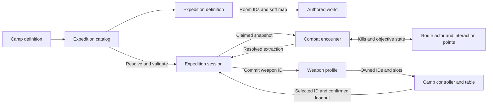

# Weapon expedition architecture

## Design contract

The [Expedition Table](../../GameDesign/Mechanics/Camp/ExpeditionBoard.md) selects a mission, then prepares the hero before launch. The [weapon rules](../../GameDesign/Mechanics/Weapons/Weapons.md#получение-оружия) distinguish finding a weapon from unlocking it. A pickup stays in the expedition bag until a living hero extracts. Death loses it. The new weapon becomes available for manual slot selection in Camp. The confirmed three-slot set stays fixed during a run. The current Camp still requires two distinct support abilities.

This delivery uses two standalone, three-room weapon searches available from the initial Camp. The supply storeroom and the guardroom borrow the settings from the [shotgun](../../GameDesign/Mechanics/Weapons/Shotgun.md) and [rifle](../../GameDesign/Mechanics/Weapons/AssaultRifle.md) designs. The planned rescue routes retain their own goals, prerequisites and placement. Both test routes include an early and a final extraction point under the [return rules](../../GameDesign/Mechanics/Expeditions/ExpeditionReturn.md). Cards remain visible as completed after successful extraction and are unavailable to launch again in this version. These are delivery decisions for the short routes.

Use one authored UWorld per route. The expedition definition orders room IDs and specifies their roles and rewards. The level owns geometry, actor placements and connections. This allows a designer to add a route by creating a map and an asset, then registering it in the catalog. The initial rules support linear weapon searches of variable length. Future branching, rescue objectives, full bag and checkpoint persistence are separate gameplay work. Ownership already supports the full weapon progression rule.

## Responsibilities and lifetimes

| Owner | Responsibility |
| --- | --- |
| `UGirlSaviorCampDefinition` | Existing Roster and Ability IDs, the shared `WeaponTable`, `CampMap` and a reference to the expedition catalog. |
| `UGirlSaviorExpeditionCatalog` | Ordered list of definitions. Resolves an ID against this table's entries. |
| `UGirlSaviorExpeditionDefinition` | Card metadata, destination, reward row ID and ordered route rules. Shared authored data with no mutable run state. |
| `AGirlSaviorCampPlayerController`, `FGirlSaviorCampPreparation` | One table visit, selected mission ID, ordered support draft, modal focus and commands. The weapon editor still owns its separate confirmation flow through the controller. |
| `UGirlSaviorExpeditionSessionSubsystem` and `FGirlSaviorExpeditionLaunch` | Existing travel handshake, immutable launch snapshot and trusted route ownership across world changes. Authorizes the final profile write for a resolved extraction. |
| `AGirlSaviorExpeditionRoute` | One route actor in the destination world. Resolves room IDs and receives the encounter's confirmed kills. Owns the room gate, single pending weapon and the authored interaction points. |
| `AGirlSaviorCombatEncounter` | Existing hero, enemies, admission, support and cleanup. Owns the terminal result and arbitrates lethal damage and extraction before publishing the outcome. |
| `UGirlSaviorWeaponProfileSubsystem` | Owns the confirmed slot order and durable set of unlocked weapon IDs. Persists changes through the current alternating save records. |
| UMG and visual Blueprint children | Render localized view data and forward interactions. Author meshes, icons, styling and scene composition here. The native actors and subsystems enforce all gameplay decisions. |

## Data Assets

Add `Expeditions/GirlSaviorExpeditionDefinition.h/.cpp` and `Expeditions/GirlSaviorExpeditionCatalog.h/.cpp` under `GirlSavior/Source/GirlSavior/`. Use `UDataAsset` and editable `UPROPERTY` fields with Russian comments, including struct members. The reference chain is Camp → catalog → definitions → card textures. Keep each texture and definition as a hard object reference. Keep the map as a soft world reference so opening the table loads card data without loading destination worlds.

| Definition field | Type | Meaning |
| --- | --- | --- |
| `MissionId` | `FName` | Stable key unique across the list. Leave it stable when renaming a display title or asset. |
| `DisplayName`, `Description` | `FText` | Localized card title and summary. |
| `LocationIcon` | `TObjectPtr<UTexture2D>` | Recognition image for the location. |
| `EnemyRoles` | `TArray<EGirlSaviorEnemyRole>` | Known enemy types in display order. Use the existing role enum with localized UI labels. Validate that the set matches the placed enemy roles on the map. |
| `DestinationMap` | `TSoftObjectPtr<UWorld>` | Saved persistent world. |
| `RewardWeaponId` | `FName` | A stable key in the existing `DT_Weapons`. Read localized reward name, icon and mesh from that row. |
| `Rooms` | `TArray<FGirlSaviorExpeditionRoomStep>` | Linear room order. Each step has `RoomId : FName` and `Rule : EGirlSaviorExpeditionRoomRule`. Rules are `PassThrough`, `DefeatPlacedEnemies` and `RewardRoom`. The last step is the sole reward room and at least one earlier step requires combat clearance. |

The catalog contains `TArray<TObjectPtr<UGirlSaviorExpeditionDefinition>> Expeditions`. Add `TObjectPtr<UGirlSaviorExpeditionCatalog> ExpeditionCatalog` to `UGirlSaviorCampDefinition`. Add a common resolver `ResolveExpedition(FName MissionId, FGirlSaviorExpeditionSpec& OutSpec, FText& OutError) const` on the Camp definition. `FGirlSaviorExpeditionSpec` is a reflected value struct containing `DestinationMap`, `MissionId`, `DisplayName`, `Description`, `LocationIcon`, `EnemyRoles`, `RewardWeaponId` and `Rooms`, plus a mode enum with `LegacyCombat` and `WeaponSearch`. Use the same resolved catalog entries for listing and launch. A map identified by the Camp package cannot also be a destination.

- Validate list identity independently of individual card content. Reject missing or duplicate IDs for the affected entries, including both sides of a duplicate. Preserve catalog order and show valid siblings even when another entry is invalid. Ignore null entries with a log message. When no card is usable, show the empty or unavailable UI state. Validate blank text or icon, invalid or duplicate roles/room IDs, bad final room rule, missing or invalid reward rows, `Pistol` as a weapon search reward, and invalid world references. Log asset path, field and ID. In the editor validate the saved world package with the same Asset Registry approach used by the Camp definition. At launch use the existing engine map-open check. Validate field rules in native `IsDataValid` and explicitly check the shared table when validating the Camp catalog. [Unreal Engine Data Validation](https://dev.epicgames.com/documentation/en-us/unreal-engine/data-validation-in-unreal-engine)
- Retain the serialized legacy fields `MissionId`, `MissionName`, `MissionDescription` and `ExpeditionMap` for saved assets and recovery fixtures. Use one synthesized `LegacyCombat` entry when the new catalog reference is null. If the new catalog is empty or its requested ID is invalid, report the configuration error. With the new catalog assigned the player-facing list has the two authored searches. Refactor `ResolveLaunchPair` to validate the support catalog and pair only. The controller's table-open and preparation gates must allow valid entries beside a broken sibling. The launch path checks shared Camp data and the selected entry, while editor validation reports issues for every authored entry.

## Launch and return contracts

1. Add `SelectMission(FName, const UGirlSaviorCampDefinition&, FText&)` to `FGirlSaviorCampPreparation`. Opening a table resets the mission selection and seeds support from the remembered pair if valid. Select the first available card in the controller. Changing mission modifies only the selected ID. Keep the existing `RequestLaunch` entry point and use `ResolveExpedition` on its draft ID before dispatch.
2. Validate that the trusted Camp contains the selected mission, the route is available, the weapon profile and ordered slots resolve, and support has two compatible offers. For a weapon search, recheck the reward is unowned. Extend the launch struct with a reflected copy of the resolved mission spec and a reflected `TObjectPtr<const UDataTable> WeaponTable`. Preserve the existing `MissionId` and `ExpeditionMap` as the travel fields, populated from this same resolution call, and validate that they agree with the spec. Preserve the copied weapon rows and support definitions. Any table or asset reference needed across travel must live in a `UPROPERTY(Transient)`.
3. Dispatch absolute travel through the existing `OpenLevelBySoftObjectPtr` path. `CampRunId` remains the sole URL option. Only the expected package in the owning game instance with the matching token claims it. The encounter validates its local scene bindings against the snapshot and initializes authored combat before `CommitLaunch`. Use the current return recovery path on a trusted setup failure. Standalone starts on existing maps retain their current mechanics. Direct starts on either new route fail in a diagnostic state with «Запустите вылазку со Стола экспедиций.» and no progression actions. A forged option or a second claimant cannot gain access to a reward.
4. Resolve extraction in the active world before the existing Camp travel request. A completed write is final even if the subsequent Camp travel fails. Retry the return with the committed result. Keep the existing Camp-ready handshake for clearing the run and the last committed support pair for the next table visit.

The existing synchronous dispatch failure path and the engine's asynchronous travel failure are two recovery paths. For the asynchronous case, record the failed request and notify local listeners after checking on the next engine tick that the same origin world is still current. Key that deferred check to the request's run ID, phase and weak origin world. A surviving Camp origin clears the failed launch and restores the open table and focus. A surviving expedition origin restores the phase held before the return request and clears pending travel. Update the visible outcome widget's status and re-enable «В лагерь» explicitly because its current initial presentation path runs once. Retain the already-published outcome. If the engine loaded a fallback world, use the existing post-load cleanup and keep any durable unlock. The old world and panel may have been torn down in that case.

Current implementation references are in [Architecture](../Architecture.md), [Camp handoff](../CampPrototype/ExpeditionHandoff.md) and [weapon loadout](../Weapons/WeaponLoadout.md). The runtime architecture index gets updated after implementation is verified.
