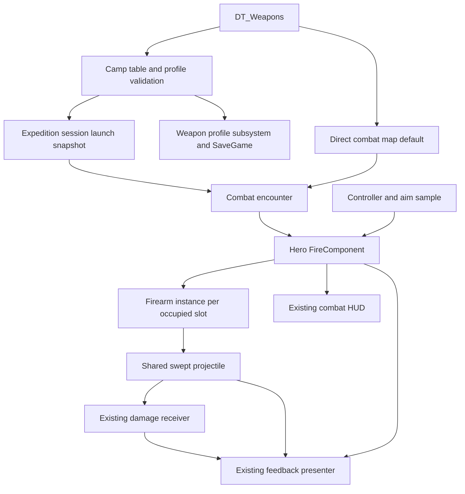

# Weapon system architecture

This document specifies the target architecture for Unreal Engine 5.9 Preview. W1–W3 implement the catalog, three firearms, expedition switching, the Camp weapon editor and persistent loadout handoff. See the [implementation plan](ImplementationPlan.md) for execution status and [current architecture](../Architecture.md) for the live wiring. Player-facing rules belong to [Weapons](../../GameDesign/Mechanics/Weapons/Weapons.md) and [Character Shooting](../../GameDesign/Mechanics/Weapons/CharacterShootSystem.md).

## Delivery

An expedition can start with any confirmed set of one to three distinct, owned weapons. The default set is `Pistol / None / None`. Equip the first populated slot at entry. The three playable rows are `Pistol`, `Shotgun`, and `AssaultRifle`. Numeric keys select slots in their saved order. The selected weapon supplies the next shot's behavior, visual, sound, and HUD identity.

This delivery includes first-blocking-hit projectiles, range and damage falloff, held fire, switching, the table editor, a durable weapon profile, feedback and checks. The current route and Camp support pair remain the playable integration points. [Camp and expedition integration](WeaponLoadout.md) defines how to play all three on the existing maps and how the future rescue routes grant ownership. Weapons have unlimited ammunition. Ranks, upgrades, reloads, full expedition checkpoints and a new inventory are outside this delivery.

## Current entry points

| Existing owner | What the implementation uses |
| --- | --- |
| `AGirlSaviorPlayerController`, `UGirlSaviorAimComponent`, `UGirlSaviorFireComponent` | Existing LMB edges and eligibility, current horizontal aim sample, post-aim tick, one fire deadline. Camp controller inherits the base controller and keeps its modal ownership. |
| `AGirlSaviorTestProjectile` | Reuse the shared combat spawn and swept sphere, ward checks, first-hit completion, flight and damage snapshot. Enemy projectiles also use this class. |
| `UGirlSaviorDamageReceiverComponent` | Owns admission, resistances, barriers, health, death, and the resolved result. |
| `AGirlSaviorCampPlayerController`, `UGirlSaviorExpeditionSessionSubsystem`, `AGirlSaviorCombatEncounter` | Own the current table flow, authenticated travel, hero binding, support, and route lifecycle. |
| `AGirlSaviorCombatFeedbackPresenter`, `AGirlSaviorCombatHUD` | Own local combat presentation and HUD binding to the possessed hero. |

The [current architecture](../Architecture.md) describes the live code and asset wiring. Update it when a stage lands and has evidence.

## Dependency and lifetime

| Owner | Lifetime and responsibility |
| --- | --- |
| `DT_Weapons` | One asset defines metadata, gameplay tuning and presentation references. Authoring is shared by Camp and combat. |
| `UGirlSaviorWeaponProfileSubsystem` | One profile per game instance. Owns unlocked row IDs and the last confirmed slot order. Saves a small versioned record. |
| `FGirlSaviorWeaponLoadout` | A reflected value with exactly three positions. Each position is a `FName`, and `NAME_None` represents an empty slot. Camp drafts and saves carry IDs. |
| `FGirlSaviorExpeditionLaunch` | The existing authenticated request additionally owns the confirmed IDs and resolved row copies. The encounter retains those copies for the run and for a rebind. |
| `UGirlSaviorFireComponent` | Already exists on the hero. Owns three instanced firearm slots, active index, input schedule and support rate multiplier. Creates firearms using `NewObject` with itself as outer and stores them in reflected `TObjectPtr` fields. |
| `UGirlSaviorFirearm` | Abstract native `UObject`. Owns a read-only row copy per instance and the common trigger-to-projectiles implementation. Subclasses generate shot directions and can update weapon-local state. A held weapon mesh is a cosmetic component owned by the existing presenter. |
| Projectile | Owns immutable launch values and is registered with the encounter. A switch, rebind or source destruction cannot rewrite a projectile already in flight. Terminal encounter cleanup still retires live projectiles. |

Use the existing Runtime module and keep gameplay rules in C++. Blueprint children supply UI layout and content. A firearm is a small runtime object because it needs behavior and state per slot. Its visual has no independent physics, pickup, or world lifetime. Keep collision, aim and actual shot cadence in their current owners. Use class references in the row to select the firing behavior. A central `switch` on row name would make every weapon extension edit the shared fire loop.

## Native boundaries

The signatures below specify the call direction and values. Headers can forward-declare pointer types and keep Unreal reflection declarations with their owning structs.

| File under `GirlSavior/Source/GirlSavior/` | Contract |
| --- | --- |
| `Weapons/GirlSaviorWeaponDefinition.{h,cpp}` | `FGirlSaviorWeaponRow : FTableRowBase`, `FGirlSaviorWeaponLoadout`, and `FGirlSaviorResolvedWeaponSlot { FName WeaponId; FGirlSaviorWeaponRow Row; }`. `ResolveWeaponLoadout(const UDataTable&, const FGirlSaviorWeaponLoadout&, TArray<FGirlSaviorResolvedWeaponSlot>&, FText&)` validates all populated entries and publishes exactly three ordered positions on success. |
| `Weapons/GirlSaviorFirearm.{h,cpp}` | `UCLASS(Abstract)` `UGirlSaviorFirearm`. `Initialize(FName, const FGirlSaviorWeaponRow&)` copies validated data. `TryFire(const FGirlSaviorWeaponFireContext&, FGirlSaviorWeaponShotCue& OutCue)` performs a discharge and reports whether it consumed a shot. Protected hooks `BuildShotDirections(const FGirlSaviorWeaponFireContext&, FGirlSaviorPreparedDischarge&) const` and `OnShotCommitted(const FGirlSaviorPreparedDischarge&, double Now)` are the weapon behavior boundary. The prepared discharge holds the directions and the copied random stream for the rifle to commit if at least one projectile launches. |
| `Weapons/GirlSaviorPistol.{h,cpp}`, `Weapons/GirlSaviorShotgun.{h,cpp}`, `Weapons/GirlSaviorAssaultRifle.{h,cpp}` | Concrete native subclasses. The pistol inherits the centered direction, the shotgun provides the fixed fan, and the rifle owns the timed spread series. Each validates the relevant authored behavior parameters. |
| `Combat/GirlSaviorFireComponent.{h,cpp}` | `ConfigureExpeditionWeapons(TConstArrayView<FGirlSaviorResolvedWeaponSlot>, int32 PreferredIndex, FText&)` builds slots in temporary storage and publishes them only after complete validation. `TrySelectWeaponSlot(int32 SlotIndex)` is a zero-based intent, validated at the component. `GetWeaponView()` returns three read-only slot descriptors and `ActiveIndex`, with `INDEX_NONE` for no active weapon. `OnWeaponChanged` and `OnWeaponShot` are native notifications. |
| `Weapons/GirlSaviorWeaponProfileSubsystem.{h,cpp}`, `Weapons/GirlSaviorWeaponSaveGame.h` | Profile read, confirmation and persistence. The profile has no pointers to Camp actors, widgets, or live firearms. [Profile contract](WeaponLoadout.md#profile-and-persistence) |

`FGirlSaviorWeaponFireContext` carries the hero, encounter, capsule-center origin, unit horizontal aim and current game time. `FGirlSaviorWeaponShotCue` carries the weapon ID, shot group ID, origin, center aim direction and the committed weapon's presentation parameters. The presenter uses the typed cue and the HUD reads `GetWeaponView()` for all three IDs, localized names, icons and the active index. Both refresh on `OnWeaponChanged` and bind to the current hero. Validate and copy DataTable rows before the run. Treat `FindRow` pointers as local to lookup. [Epic DataTable documentation](https://dev.epicgames.com/documentation/unreal-engine/data-driven-gameplay-elements-in-unreal-engine)

## Extension

For an extra firearm with existing behavior, add a row using a suitable existing class, distinct art and a new stable row key. For new firing behavior, add a subclass and validate its data at catalog resolution. Register sources that use a different delivery mechanism when that feature is designed. Camp, slot switching and HUD continue to work through row IDs and view data. A renamed ID requires a save migration before release.
